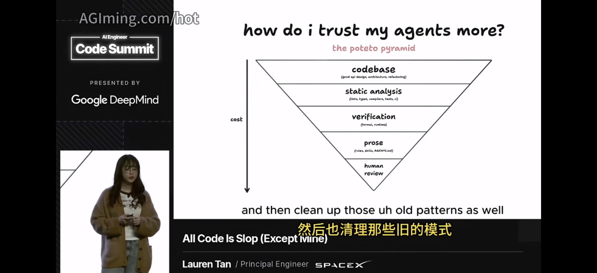
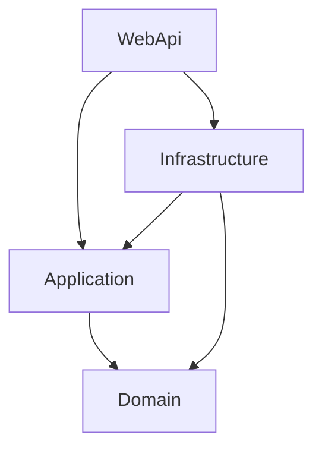
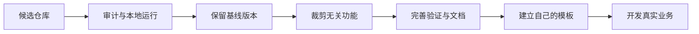
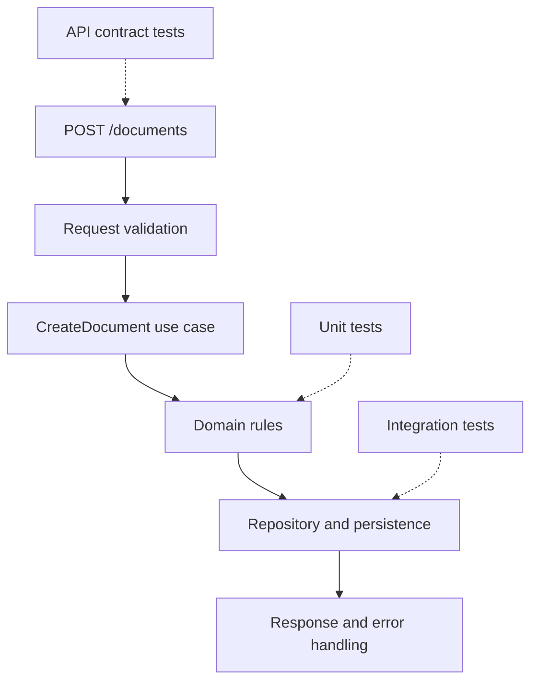
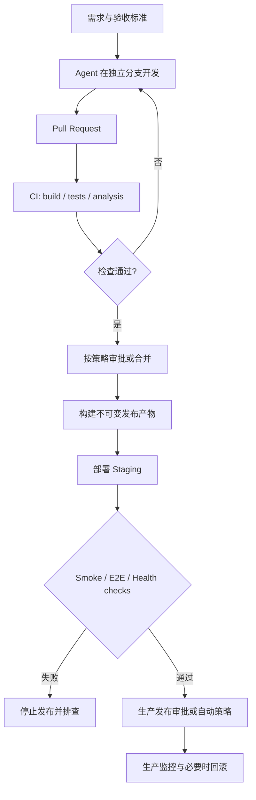
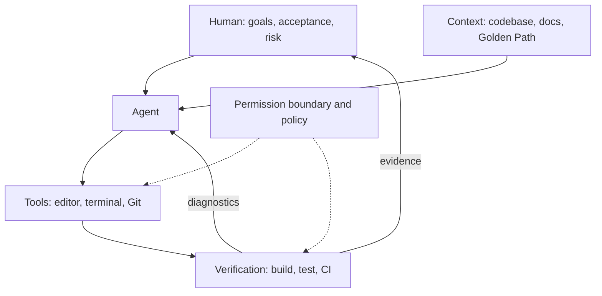

# AI 驱动的软件工程：从基础代码库到 Agent Harness

> 核心原则：让 AI 负责更多实现工作，让工程系统负责可重复的验证，让人负责目标、边界、风险与最终责任。

本文从《All Code Is Slop (Except Mine)》演讲中的 Poteto Pyramid 出发，结合开源代码复用、Golden Path 和 CI/CD，整理成适合个人开发者的实践指南。面向有 C#/.NET 与 Clean Architecture 经验、希望使用 Python、RAG 和 AI Agent 开发产品的工程师。

**来源与核实状态：** 本文不是演讲逐字稿。

- 五层名称和图中文字已对照演讲截图核实，但没有对照完整演讲视频逐项核对。
- 演讲日期、poteto 的含义和演讲者团队的实例来自二手报道（见 12.1），文中以“据报道”标出。
- 各层的展开说明、示例和实施路线是我对这些理念的应用与扩展，不是演讲者的主张。
- 示例代码、CI 配置和候选开源项目都没有在真实仓库中运行或审计，使用前需自行核实。

## 目录

1. [核心思想](#1-核心思想)
2. [工程约束的优先级](#2-工程约束的优先级)
3. [基础代码库](#3-基础代码库)
4. [开源项目的选择与改造](#4-开源项目的选择与改造)
5. [Golden Path](#5-golden-path)
6. [CI/CD 与 AI 的职责](#6-cicd-与-ai-的职责)
7. [Harness Engineering](#7-harness-engineering)
8. [实际开发工作流](#8-实际开发工作流)
9. [RAG 与 Agent 项目的特殊要求](#9-rag-与-agent-项目的特殊要求)
10. [个人实施路线](#10-个人实施路线)
11. [可复用的指令与检查清单](#11-可复用的指令与检查清单)
12. [参考资源与结论](#12-参考资源与结论)

## 1. 核心思想

传统的软件开发中，人编写代码，自动化工具协助人发现问题。AI 驱动的软件开发中，Agent 可以承担大量实现、测试补充、文档和局部重构工作，但系统质量仍取决于开发者对架构、验收标准和验证机制的设计。

关键不是追求一次生成完美代码，而是缩短从错误发生到发现、修复和防止复发的反馈周期。

| 传统开发 | AI 驱动开发 |
|---|---|
| 人阅读需求并实现 | 人定义目标和验收标准，Agent 实现 |
| 人反复检查常规错误 | 编译器、测试、分析器优先发现错误 |
| 代码规范主要依靠团队自律 | 规范逐步转化为可执行规则 |
| 基础设施建设耗费大量手工时间 | Agent 协助建设和维护基础设施 |
| 人承担软件质量责任 | 人仍承担质量与发布责任 |

这不是取消人工 Code Review，而是减少重复、低价值的审查工作，将人工注意力集中在业务正确性、安全、架构决策和风险上。

## 2. 工程约束的优先级

### 2.1 原始演讲：《All Code Is Slop (Except Mine)》

- **演讲标题**：All Code Is Slop (Except Mine)，可译为「所有代码都是垃圾（除了我的）」。标题带有反讽意味。
- **演讲者**：截图署名 Lauren Tan / Principal Engineer / SpaceX。
- **活动**：AI Engineer Code Summit，截图标注 Presented by Google DeepMind。据二手报道，演讲时间为 2026 年 11 月 11 日，在主舞台进行。
- **幻灯片标题**：how do i trust my agents more?（如何更加信任我的 Agent？）
- **模型名称**：the poteto pyramid（保留截图中的原始拼写）。poteto 是演讲者的网络 ID（GitHub 账号 `poteto`），不是 potato 的拼写错误；这个 ID 本身的由来未查到本人说明。

#### 原始演讲截图



*来源：演讲视频截图（转载版本，带第三方水印和字幕）。*

#### 倒金字塔：The Poteto Pyramid

| 原图层级（从上至下） | 原图括号内文字 | 中文解释 |
|---|---|---|
| Codebase | good api design, architecture, refactoring | 良好的 API 设计、架构、重构 |
| Static analysis | lints, types, compilers, tests, ci | Lint、类型、编译器、测试、持续集成 |
| Verification | formal, runtime | 形式化验证与运行时验证 |
| Prose | rules, skills, AGENTS.md | 自然语言规则、技能、Agent 指令文件 |
| Human review | — | 人工审查 |

注意：原图把 tests 和 CI 归入 static analysis。严格的软件工程术语中，执行测试属于动态验证，CI 是组织各项检查的流水线，不是静态分析技术本身；这里可以把这一层理解为“合并前自动运行的全部检查”。下文 2.2–2.6 按原图的分法展开。

#### 从演讲截图提炼的工程思路

倒金字塔把代码库放在最宽的一层，左侧的 cost 箭头指向下方。直接的读法是：越往下，每发现或纠正一个问题的成本越高，人工审查最贵。所以问题应尽量在上层解决：能靠代码库设计避免的，不留给检查；能靠自动检查发现的，不留给文字规则；能靠文字规则说明的，不留给人工审查。

我的保留意见：箭头描述的是反复使用时的成本，不是建设成本，整理代码库或引入形式化验证的初始投入可能很高。下层也不能取消：有些业务判断只能用文字说明，人工审查要留给上层无法判断的问题。所以这个顺序是优先级，不是对每个项目都成立的精确排名，实践中按风险和投入收益组合使用。

各类问题对应的具体工程措施见 [7.1](#71-让错误变成永久性约束)。

> 工程目标：不要仅仅告诉 AI 怎样做正确的事，还要建立一个让错误难以发生、容易被发现、无法轻易绕过验证的系统。

### 2.2 Codebase

最好的约束是让错误的实现方式难以出现。例如：

- 通过项目引用关系限制依赖方向（架构测试示例见 3.3）。
- 通过封装、不可变类型和值对象维护业务不变量。
- 通过统一 API 和明确接口减少 Agent 随意发明新模式的机会。
- 使用现有的优质业务模块作为参考实现。

据报道，演讲者团队的一个例子是在产品代码中禁用 React 的 `useEffect`，因为它容易被误用：与其反复提醒 Agent 正确使用，不如直接拿掉这个选项。

注意：代码库也可能包含历史反模式。Agent 容易模仿已有代码，所以必须明确哪些实现值得复用，哪些属于待偿还的技术债务。

### 2.3 Static analysis

原图在这一层列出 lints、types、compilers、tests、ci，也就是代码合并前自动运行的检查：编译器、类型检查、Lint、架构依赖检查，以及由 CI 统一执行的单元测试、集成测试、契约测试和端到端测试。它们通常比文字提醒更稳定，因为相同的代码和配置能够得到可重复的检查结果。

测试通过只代表已定义的检查通过，并不意味着程序没有任何缺陷。

### 2.4 Verification

原图在这一层只写了 formal 和 runtime。按我的理解：

- 形式化验证：用规约、模型检查或证明工具确认关键性质，投入高，适合少数核心逻辑。
- 运行时验证：在程序实际运行时确认行为，例如运行时断言与不变量检查、健康检查、smoke test，以及 RAG 和 Agent 的评估。

据报道，演讲者团队用 TLA+ 做模型检查、用 Lean 证明算法正确性，理由是 Agent 降低了人力成本，这些以往太贵的方法现在用得起了。演讲者对这两项的具体定义以原演讲为准。

### 2.5 Prose

AGENTS.md、Skills、README、ADR 和任务说明可以传达业务背景、设计理由和开发流程。文字约束无法保证一定被遵守，重要规则应尽可能配合自动检查。

### 2.6 Human review

人负责机器无法充分判断的事项：需求是否合理、测试是否覆盖真正风险、架构是否适合长期演进、敏感数据与权限设计是否安全。

## 3. 基础代码库

基础代码库不是大量预先写好的业务代码，而是一套能够运行、能够验证、能够持续扩展的最小工程环境。

### 3.1 最小组成

| 组成 | 目的 | 初期优先级 |
|---|---|---|
| Architecture | 定义模块与依赖方向 | 必须 |
| Reference implementation | 提供可模仿的业务范例 | 必须 |
| Build & test | 提供可执行验证入口 | 必须 |
| CI | 保证每次变更都执行检查 | 必须 |
| Agent context | 描述工程约定与操作方式 | 必须 |
| Observability | 支持排查实际运行问题 | 按需求 |
| CD | 自动化部署及回滚 | 有部署需求时 |

### 3.2 .NET 示例目录

```text
my-product/
├── src/
│   ├── Domain/
│   ├── Application/
│   ├── Infrastructure/
│   └── WebApi/
├── tests/
│   ├── UnitTests/
│   ├── IntegrationTests/
│   └── ArchitectureTests/
├── docs/
│   ├── architecture.md
│   └── adr/
├── .github/
│   ├── workflows/
│   └── CODEOWNERS
├── AGENTS.md
├── README.md
├── Directory.Build.props
├── .editorconfig
└── docker-compose.yml
```

这是通用示例，不是 `New-Project.ps1` 生成的实际目录，生成项目后以实际结构为准。也并非所有项目都必须采用四层 Clean Architecture。简单工具或 CRUD 应用可能更适合较轻的模块化设计。



箭头表示允许的依赖方向；WebApi 对 Infrastructure 的引用主要用于组合根和依赖注入。Domain 不应依赖 WebApi、数据库或具体外部服务。

### 3.3 自动化架构约束

例如使用 ArchUnitNET、NetArchTest 或自定义检查，验证 Domain 不引用 Infrastructure。以下为 NetArchTest 风格示例，命名空间和程序集需按实际项目调整：

```csharp
var result = Types.InAssembly(domainAssembly)
    .ShouldNot()
    .HaveDependencyOn("MyProduct.Infrastructure")
    .GetResult();
Assert.True(result.IsSuccessful);
```

同时使用项目引用限制、编译器和架构测试，避免仅靠 AGENTS.md 里一句“遵守 Clean Architecture”。

## 4. 开源项目的选择与改造

### 4.1 三种复用模式

| 模式 | 适用情形 | 注意事项 |
|---|---|---|
| Starter Template | 新产品，需要成熟工程骨架 | 移除不需要的依赖和功能 |
| Fork & Extend | 已有产品与目标高度相似 | 考虑上游升级、授权及长期维护 |
| Reference Repository | 保留自己的架构，借鉴特定实现 | 不盲目复制代码和设计 |

不需要亲自重写全部基础设施。可以选择优秀开源项目，审计、裁剪，再形成自己的基线。

### 4.2 候选项目

以下是可以考虑的公开仓库，选用前按 4.3 的清单审计。其中 Jason Taylor CleanArchitecture 和 Full Stack FastAPI Template 已在本仓库的 `New-Project.ps1` 中固定了具体版本，见 [README](README.md)。

| 项目 | 方向 |
|---|---|
| [Jason Taylor CleanArchitecture](https://github.com/jasontaylordev/CleanArchitecture) | .NET 架构模板 |
| [Ardalis CleanArchitecture](https://github.com/ardalis/CleanArchitecture) | .NET、领域建模 |
| [Full Stack FastAPI Template](https://github.com/fastapi/full-stack-fastapi-template) | Python 全栈应用 |
| [LangGraph](https://github.com/langchain-ai/langgraph) | Agent 工作流框架及参考实现 |
| [LlamaIndex](https://github.com/run-llama/llama_index) | RAG 框架及参考实现 |

LangGraph 和 LlamaIndex 更适合作为框架或参考仓库，不必直接 Fork 整个项目来开发自己的产品。

### 4.3 评估清单

- [ ] 许可证允许计划中的使用、修改和发布；保留必要版权声明。
- [ ] 在干净环境中能够按照 README 启动。
- [ ] 测试能够运行，且具有实际断言和有效覆盖。
- [ ] 核心架构能够理解，依赖关系清楚。
- [ ] 有明确的参考实现，代码风格一致。
- [ ] 技术栈与实际需求匹配，而非单纯追求 Stars。
- [ ] 检查依赖、漏洞、维护状态及升级成本。
- [ ] 检查 CI 工作流、安装脚本、Dockerfile 与第三方 Actions。
- [ ] 检查默认凭据、遥测、权限和外部网络访问。
- [ ] 记录基线版本或 commit，以及与上游的关系。

### 4.4 改造过程



安全注意：不要让 Agent 在尚未审计的仓库中直接执行任意脚本，也不要把带有生产凭据的环境交给未知代码。初次运行使用隔离环境和最小权限。

## 5. Golden Path

Golden Path 指一个高质量的端到端参考实现。它提供 Agent 可以直接观察、复用和验证的标准路径。

以知识管理系统的 Document 模块为例，先完成创建文档这一条垂直业务链路：



参考实现应包括正常路径、输入无效、权限不足、资源不存在、持久化失败等必要场景；具体范围取决于产品。

然后开发 Tag 模块时，要求 Agent 参考 Document 模块，而不是从头决定所有模式。但不能机械复制：Tag 与 Document 的业务规则可能不同，不需要的抽象不应照搬。

## 6. CI/CD 与 AI 的职责

### 6.1 可以让 AI 做什么？

| 任务 | 推荐授权 |
|---|---|
| 编写 GitHub Actions、Dockerfile | Agent 起草与修改，人工验收 |
| 配置 build、lint、单元及集成测试 | Agent 主导实施 |
| 配置架构测试与依赖扫描 | Agent 主导实施，规则由人确认 |
| 排查构建失败 | Agent 根据日志定位并提交修复 |
| 部署临时或测试环境 | 在预授权范围内自动执行 |
| 发布生产环境 | 初期使用人工审批，成熟后按风险自动化 |
| 修改质量门禁、权限或 secrets | 受独立审批和平台权限控制 |

### 6.2 CI 和 CD 的区别

CI（Continuous Integration）关注每次变更的集成与验证。CD 可以指 Continuous Delivery（保持可发布状态）或 Continuous Deployment（通过门禁后自动发布）。不要将 CI 通过等同于生产发布安全。



### 6.3 .NET CI 示例

以下为最小示例。.NET 10 仅为示例，请按实际 `global.json` 和项目目标框架调整。

```yaml
name: CI
on:
  pull_request:
  push:
    branches: [main]
permissions:
  contents: read
jobs:
  verify:
    runs-on: ubuntu-latest
    steps:
      - uses: actions/checkout@v7
      - uses: actions/setup-dotnet@v6
        with:
          dotnet-version: '10.0.x'
      - run: dotnet restore
      - run: dotnet build --no-restore -c Release
      - run: dotnet test --no-build -c Release
```

示例中的 Actions 版本是 2026 年 11 月查到的最新主版本，实际使用时仍应核实；生产级工作流可固定到审计过的完整 commit SHA，并按项目添加格式检查、架构测试、集成测试、依赖扫描与产物管理。不要在不可信 PR 工作流中暴露生产 secrets。

### 6.4 保护验证机制

最典型的问题是 Agent 为了让 CI 变绿而删除测试、修改断言、跳过检查或者扩大权限。

应保护的对象包括：

```text
.github/workflows/
.github/CODEOWNERS
tests/ArchitectureTests/
Directory.Build.props
.editorconfig
部署配置与基础设施定义
关键业务验收测试
```

建议措施：

- main 分支不允许普通 Agent 直接推送。
- 要求 PR 通过指定检查；保护规则本身由独立权限管理。
- 关键文件使用 CODEOWNERS，并结合强制审批规则；单独存在 CODEOWNERS 不代表强制保护。
- Agent token 默认最小权限，不具备管理员或规则绕过权限。
- 生产环境使用独立凭据、环境审批及限制部署来源。
- 测试修改允许合理演进，但弱化验收标准需要独立审核。
- 根据平台套餐和仓库可见性核实具体保护功能是否可用。

对只有一个人的项目，独立审批意味着 Agent 提出变更，由你本人审批，不能让 Agent 同时持有可绕过规则的凭据。

### 6.5 CD 的额外要求

生产部署应考虑不可变构建产物、版本标识、健康检查、超时、失败告警、回滚及数据库迁移兼容性。数据库变更不一定可通过回滚应用版本撤销，因此必须单独设计恢复方案。低风险个人应用可逐步提高自动化程度，而涉及支付、隐私和不可逆操作的系统应采用更严格门禁。

## 7. Harness Engineering

Harness Engineering 在本文中指围绕 Agent 建设的一整套执行、上下文、权限、反馈和验证环境。它不是某个特定框架，也不等同于 CI/CD。

| 概念 | 核心问题 | 典型产物 |
|---|---|---|
| Prompt Engineering | 如何表达任务 | 指令与验收标准 |
| Context Engineering | 如何提供正确的信息 | 架构文档、代码示例、检索上下文 |
| Harness Engineering | 如何让 Agent 在受控环境中执行并纠错 | 工具权限、沙箱、测试、反馈闭环 |
| Software Engineering | 如何保证整个系统可靠、可维护 | 架构、测试、交付与运营体系 |



Harness 的重点是让 Agent 获得真实反馈，而不是自己宣称任务完成。例如，Agent 必须执行测试、读取退出状态和失败日志、检查实际变更，并在不能验证时明确报告。

### 7.1 让错误变成永久性约束

| 发生的问题 | 优先考虑的工程措施 |
|---|---|
| Agent 复制旧的反模式 | 清理代码库、重构并建立正确范例 |
| Agent 生成无法编译的代码 | 编译检查、类型检查与 CI |
| Agent 实现的业务行为不正确 | 独立验收标准、测试与运行时验证 |
| Agent 不理解业务约定 | AGENTS.md、Skills 与设计文档 |
| Agent 修改生产权限或安全策略 | 受保护的规则、人工审批与审计 |
| Domain 依赖 Infrastructure | 项目依赖约束及架构测试 |
| 忘记处理空值 | Nullable Reference Types 与编译警告策略 |
| API 破坏向后兼容性 | OpenAPI 差异检查、契约测试 |
| 权限校验遗漏 | 访问控制集成测试、默认拒绝策略 |
| 引入有漏洞的依赖 | 依赖扫描与升级策略 |
| 页面变更破坏交互 | Playwright E2E 测试 |
| 发布后服务不可用 | Smoke test、健康检查和告警 |
| RAG 检索质量下降 | 固定评估集与检索指标 |
| 产品里的 Agent 越权调用工具 | 工具权限校验、审计与拒绝测试 |

持续改进循环：发现问题 → 定位原因 → 修复 → 添加回归检查 → 确认检查能捕获原始问题 → 纳入日常验证。

并非每个错误都值得新增规则。根据复发概率、影响、误报和维护成本决定，避免形成脆弱且运行缓慢的测试体系。

## 8. 实际开发工作流

人与 AI 的分工见第 1 节，CI/CD 相关的授权见 6.1 节。

### 8.1 单次任务的标准流程

1. 明确业务行为、约束、非目标和验收场景。
2. Agent 阅读架构文档、AGENTS.md 和 Golden Path。
3. 在独立分支上进行小范围修改，避免无关重构。
4. 增加或更新能体现业务行为的测试。
5. 执行本地构建与测试，修复真实问题。
6. 检查 diff、依赖变化、权限和敏感信息。
7. 提交 PR，CI 独立执行检查。
8. 根据风险进行人工审批或自动合并。
9. 部署后验证，必要时回滚；记录新的工程经验。

### 8.2 示例：开发文档标签功能

需求：用户可以为自己的文档添加标签；标签在用户范围内唯一；不同用户不可访问彼此的文档或标签。

验收条件：正常添加、重复添加的幂等行为、无效名称、文档不存在、跨用户访问被拒绝、持久化正确。具体 HTTP 状态码和重复添加语义由产品设计决定。

Agent 参考现有 Document 模块，实现 Tag 相关业务，复用现有异常处理和数据库访问模式，提供集成测试。CI 验证编译、单元测试、权限测试和架构规则。人工重点审查唯一性约束、并发行为和租户隔离，而非逐行检查格式。

## 9. RAG 与 Agent 项目的特殊要求

传统软件的自动化验证通常有明确输入输出。LLM 系统存在概率性输出、模型升级和外部工具不确定性，因此需要在常规测试之外建立评估体系。

本节的 Agent 指产品里运行的 Agent，不是前文帮你写代码的 Agent。

### 9.1 Python 项目骨架示例

```text
ai-product/
├── src/
│   ├── api/
│   ├── application/
│   ├── retrieval/
│   ├── agents/
│   └── infrastructure/
├── tests/
│   ├── unit/
│   ├── integration/
│   └── security/
├── evals/
│   ├── datasets/
│   ├── retrieval/
│   └── agent/
├── docs/
├── pyproject.toml
├── AGENTS.md
└── .github/workflows/
```

Python 可以使用 pytest、Ruff、mypy 或 Pyright 等工具；选取适合实际项目的组合即可，不必重复引入功能类似的工具。

### 9.2 RAG 的验证

- 数据摄取：文档解析、分块、元数据、删除和索引更新是否正确。
- 检索：使用带标准相关文档的评估集，观察 Recall@K、MRR 等指标。
- 生成：答案是否基于检索证据，引用是否准确，缺少证据时是否明确表达不确定性。
- 安全：不同用户或租户的数据隔离、文档中的 prompt injection、敏感数据泄露。
- 运营：延迟、token 成本、检索失败、模型与 embedding 版本变化。

评估集应包含真实问题、边界问题、无答案问题和恶意输入。LLM-as-judge 可以作为辅助指标，但不能当作完全确定的事实验证器；应校准评分并定期人工抽样。

### 9.3 Agent 的验证

Agent 的成功不只是生成看似合理的文本，还包括正确选择工具、参数正确、遵守权限、在规定步数内结束，以及没有发生未授权的副作用。

| 测试类型 | 示例 |
|---|---|
| Tool contract | 参数 schema、返回值、异常处理 |
| Workflow | 状态转换、重试、超时、终止条件 |
| Authorization | 越权工具调用必须被系统拒绝 |
| Idempotency | 重复执行不能造成重复扣费或重复写入 |
| Evaluation | 任务完成率、错误操作率、延迟和成本 |
| Human-in-the-loop | 高风险操作需要明确授权 |

建议在每次 PR 中运行快速且可重复的 mock 测试；将成本较高、涉及真实模型的评估放到受控的定期任务或发布前检查中。为评估设定基线与容忍范围，而非要求所有概率性输出逐字相同。

## 10. 个人实施路线

### 阶段一：选择并建立最小基础库

- 明确第一个产品的实际需求、部署方式和数据风险。
- 选择一到两个开源候选，审计许可证、依赖和架构。
- 在隔离环境中运行并验证现有测试。
- 裁剪与业务无关的模块，保存可追溯的基线。
- 启用最小 CI：每次变更自动构建并运行现有测试（示例见 6.3）。

本仓库的 `New-Project.ps1` 是这一步的起点：它按固定版本生成上游模板（见 [README](README.md)）。审计、裁剪和验证仍要在生成的项目里完成。

**完成标准：** 新环境能启动项目，基础构建与测试在本地和 CI 中都通过，知道为什么保留每个主要依赖。

### 阶段二：建立 Golden Path

选择一个真实业务功能，从 API 到持久化和测试完整实现。将重要设计决定写入简短 ADR。让 Agent 协助实现，但由人确认范例质量。

**完成标准：** Agent 可以参考该功能开发第二个功能，不需要重新发明架构。

### 阶段三：加固 CI 与工程门禁

在阶段一的最小 CI 上，让 Agent 加入分析器和架构检查。故意引入一项已知错误验证门禁确实失败，再恢复代码。保护主分支、关键配置和凭据。

**完成标准：** 错误变更无法在未获批准的情况下通过必要门禁；正常变更可重复验证。

### 阶段四：搭建 CD 和运行反馈

先自动部署测试环境，验证服务启动、关键业务链路及日志。确定发布产物、版本和回滚方式。生产环境初期保留人工审批。

**完成标准：** 发布失败能够被发现，旧版本可按已验证的恢复流程恢复；迁移风险有单独方案。

### 阶段五：沉淀自己的工程资产

```text
engineering-assets/
├── dotnet-starter
├── python-starter
├── rag-starter
├── agent-starter
├── engineering-skills
├── architecture-rules
└── reference-implementations
```

不必一开始创建全部仓库。先完成一个真实项目，发现稳定的复用模式后再提取模板，避免过早抽象和维护多个空壳项目。本仓库目前只固定上游版本，不含自己的约定；等约定在真实项目里稳定后，再回填到这里。

### 阶段六：逐步增加 Agent 自主性

从只读分析、提出变更、独立分支编码，到自动提交 PR、低风险自动合并、受控部署，逐步扩大权限。每一次扩大权限应基于验证能力和实际风险，而不是模型表现看起来更聪明。

## 11. 可复用的指令与检查清单

### 11.1 AGENTS.md 示例

下面的文件可作为起点，路径和命令需按真实项目修改。它属于协作约定，不能替代权限和自动化门禁。

```markdown
# Repository instructions

## Architecture
- Follow existing module boundaries and dependency direction.
- Use the Document feature as the reference implementation.
- Do not introduce new dependencies or architectural patterns without justification.

## Workflow
- Read relevant code and tests before making changes.
- Keep changes focused on the requested behavior.
- Add regression tests for bug fixes.
- Run the relevant build and test commands before reporting completion.

## Verification
- dotnet build -c Release
- dotnet test -c Release
- Report actual results and any checks that could not be executed.

## Protected changes
- Do not weaken tests, skip required checks, or change CI policies to make a task pass.
- Propose changes to workflows, security policies, or production infrastructure separately.
- Never include secrets in source code, logs, or commits.
- Do not deploy to production or perform destructive operations without authorization.

## Completion
- Summarize changes, tests, risks, and unresolved issues.
```

### 11.2 让 AI 审计开源基础库的 Prompt

```text
Review this repository as a candidate starter for my product.
Do not modify files or execute unreviewed installation scripts.

1. Explain architecture, dependency direction and major design decisions.
2. Identify reference implementations and inconsistent patterns.
3. Review license obligations, dependencies, CI and deployment configuration.
4. Identify security risks, required secrets and external services.
5. Assess test quality and reproducibility, distinguishing inspected evidence
   from assumptions.
6. Recommend what to keep, remove or refactor for a minimal starter.
7. Produce a prioritized plan with acceptance criteria and unresolved questions.
```

### 11.3 让 AI 建设 CI 的 Prompt

```text
Implement a minimal CI workflow for this repository.
Inspect its existing SDK, build scripts, test projects and conventions first.
Run build, unit tests, integration tests where feasible, and architecture checks.
Use least-privilege workflow permissions and avoid exposing secrets to PRs.
Do not alter business assertions or disable checks to obtain a passing result.
Explain workflow triggers, verification coverage and known limitations.
Provide evidence of successful checks, and report checks not executed.
Propose branch protection and protected-file rules separately for my approval.
```

### 11.4 发布前检查清单

- [ ] 验收标准明确，业务风险已识别。
- [ ] 实现符合现有架构，diff 不包含无关改动。
- [ ] 必要测试和静态检查通过，失败没有被隐藏。
- [ ] 涉及关键规则的变更已单独审核。
- [ ] 新依赖、权限变化、敏感数据处理已检查。
- [ ] 测试环境验证通过，发布产物可追溯。
- [ ] 数据库迁移和恢复方案已明确。
- [ ] 生产部署符合批准的发布策略。
- [ ] 监控、告警和必要回滚能力可用。

## 12. 参考资源与结论

### 12.1 进一步学习

- 原始演讲：《All Code Is Slop (Except Mine)》；第 2 节收录 The Poteto Pyramid 幻灯片截图及转录。完整视频可通过 [YouTube 按标题搜索](https://www.youtube.com/results?search_query=All+Code+Is+Slop+Except+Mine+Lauren+Tan) 查找。
- 演讲的二手报道（日期、poteto 的含义、`useEffect` 与 TLA+/Lean 实例的出处；各家对演讲者职位和所属公司的说法不一致）：[INSIDE](https://www.inside.com.tw/article/42920-lauren-tan-spacexsi-trust-pyramid-ai-engineer-code-2026)、[Web Reactiva](https://www.webreactiva.com/blog/all-code-is-slop-poteto)、[AI Engineer Guide](https://aiengineerguide.com/til/all-code-is-slop-except-mine-by-lauren-tan/)。
- [GitHub Actions 官方文档](https://docs.github.com/en/actions)
- [GitHub 仓库规则文档](https://docs.github.com/en/repositories/configuring-branches-and-merges-in-your-repository/managing-rulesets)
- [.NET 测试文档](https://learn.microsoft.com/en-us/dotnet/core/testing/)
- [AGENTS.md](https://agents.md/)
- [OWASP Top 10 for LLM Applications](https://genai.owasp.org/)

官方文档链接是进一步阅读的入口，我没有逐项核对它们的当前内容。

### 12.2 最值得积累的能力

对于已有多年 .NET 和 Clean Architecture 经验的开发者，优先投入架构与代码库设计、自动化测试、可执行验证、CI/CD 和 Agent Harness。Prompt 与上下文工程仍然重要，但它们应该服务于整体工程体系，而不是独自承担质量保证责任。

最终目标不是打造一套永远不出错的 AI，而是打造一套错误容易被发现、难以绕过验证、风险能够控制、经验可以不断沉淀的软件工程系统。

> Minimum Viable Architecture → Golden Path → Engineering Guardrails → Agent-driven Development → Continuous Improvement

> AI 可以建设规则，但不能为了通过规则而擅自降低规则。人可以把实现工作委托给 AI，却不能把质量责任一并委托出去。
